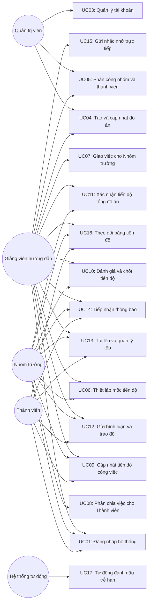

# Sơ đồ Ca sử dụng (Use Case Diagram)

> **Cách xem sơ đồ:** Xem trực tiếp trên giao diện GitHub hoặc sao chép nội dung trong khối mã dán vào trang [Mermaid Live Editor](https://mermaid.live).  
> **Quy chuẩn thiết kế:** Tên tất cả các ca sử dụng (Use Case) trong sơ đồ đều bắt đầu bằng **Động từ hành động** (Action Verb) đại diện cho chức năng của hệ thống.

## Ghi chú kỹ thuật
- **UC02 (Đăng xuất hệ thống):** Là hành động áp dụng chung cho tất cả các tác tử sau khi đã đăng nhập thành công (được ẩn bớt đường nối trên sơ đồ để tránh rối mắt).
- Sinh viên có thể xuất sơ đồ sang dạng hình ảnh (.PNG/.SVG) hoặc vẽ lại trên StarUML/Draw.io để đưa vào tài liệu báo cáo Word Đồ án cơ sở.
