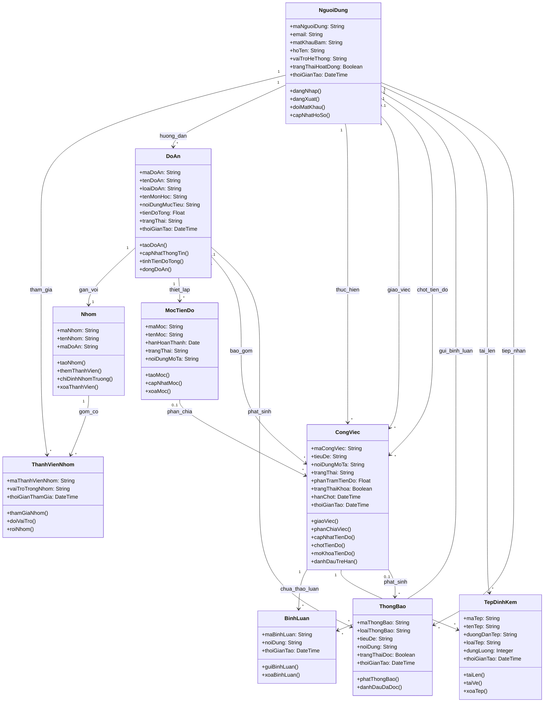

# Sơ đồ Lớp (Class Diagram - Mức miền nghiệp vụ)

> **Cách xem sơ đồ:** Xem trên giao diện GitHub hoặc sao chép mã dán vào trang [Mermaid Live Editor](https://mermaid.live).  
> **Quy chuẩn danh pháp:**  
> - **Thuộc tính (Attributes):** 100% sử dụng **Danh từ** hoặc **Cụm danh từ**.  
> - **Phương thức (Methods / Operations) & Nhãn quan hệ (Associations):** 100% sử dụng **Động từ hành động**.

## Chú thích miền giá trị thuộc tính (Danh từ)
- **`NguoiDung.vaiTroHeThong`:** `QuanTriVien` (Quản trị viên), `GiangVien` (Giảng viên hướng dẫn), `SinhVien` (Sinh viên).
- **`ThanhVienNhom.vaiTroTrongNhom`:** `NhomTruong` (Nhóm trưởng), `ThanhVien` (Thành viên nhóm).
- **`CongViec.trangThai`:** `CanLam` (Cần làm / To-do), `DangLam` (Đang thực hiện), `HoanThanh` (Đã hoàn thành), `TreHan` (Quá thời hạn hoàn thành).
- **`DoAn.loaiDoAn`:** `MonHoc` (Đồ án môn học), `CoSo` (Đồ án cơ sở ngành), `ChuyenNganh` (Đồ án chuyên ngành).
- **Mối quan hệ Đồ án — Nhóm:** Tỷ lệ 1 — 1 (Mỗi đồ án có đúng 1 nhóm sinh viên thực hiện).
