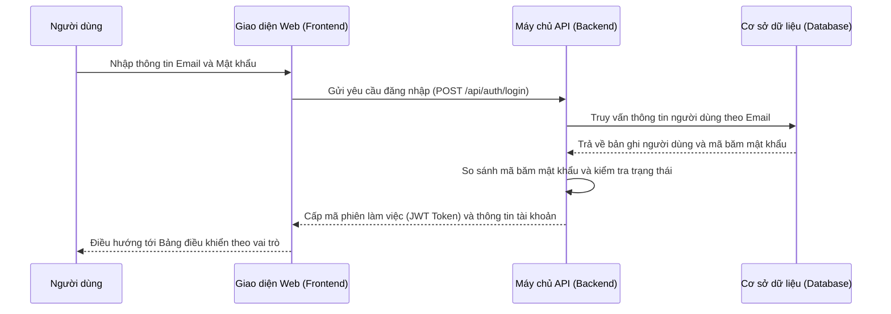
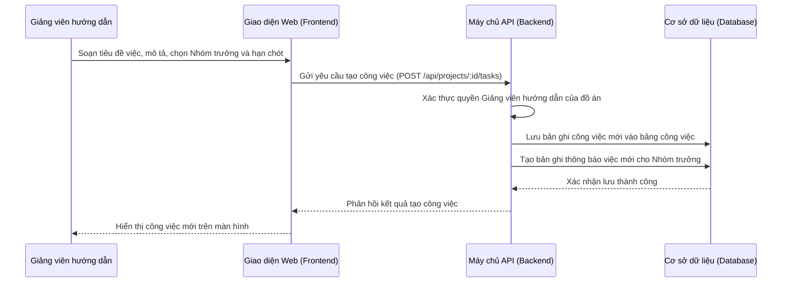
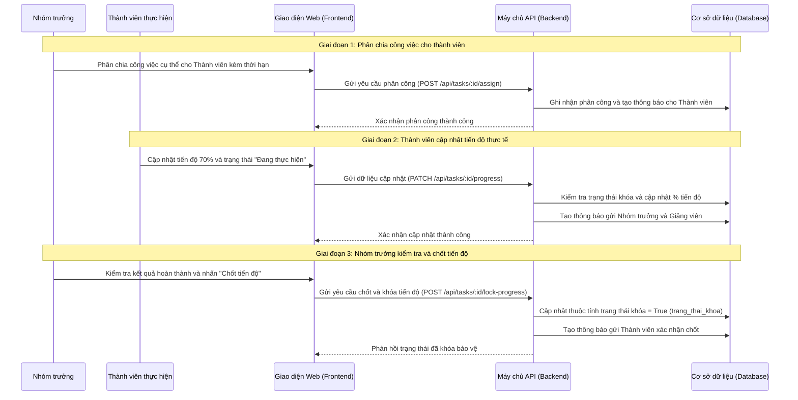
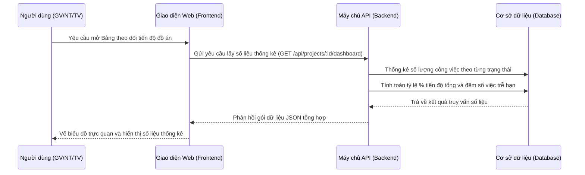

# Sơ đồ Tuần tự (Sequence Diagrams)

> **Cách xem sơ đồ:** Xem trên giao diện GitHub hoặc sao chép mã dán vào trang [Mermaid Live Editor](https://mermaid.live).  
> **Quy chuẩn thiết kế:** Toàn bộ thông điệp (Messages) giữa các đối tượng trong sơ đồ tuần tự đều sử dụng **Động từ hành động** (Action Verbs).

---

## 1. Quy trình Đăng nhập hệ thống

---

## 2. Quy trình Giảng viên giao việc cho Nhóm trưởng

---

## 3. Quy trình Phân việc, Cập nhật tiến độ và Chốt tiến độ công việc

---

## 4. Quy trình Tổng hợp và Hiển thị Bảng điều khiển tiến độ (Dashboard)

