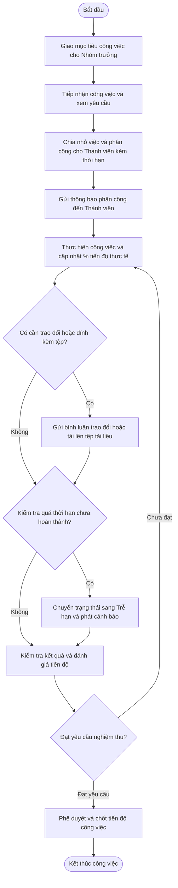
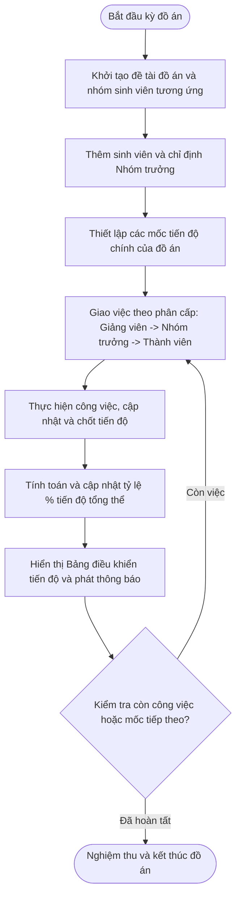

# Sơ đồ Hoạt động (Activity Diagrams)

> **Cách xem sơ đồ:** Xem trên giao diện GitHub hoặc sao chép mã dán vào trang [Mermaid Live Editor](https://mermaid.live).  
> **Quy chuẩn thiết kế:** Toàn bộ các nút hành động (Action / Activity Nodes) trong sơ đồ hoạt động đều bắt đầu bằng **Động từ hành động** (Action Verbs).

---

## 1. Quy trình tạo, thực hiện và hoàn thành một công việc trong nhóm

---

## 2. Quy trình theo dõi và quản lý tiến độ tổng thể đồ án

