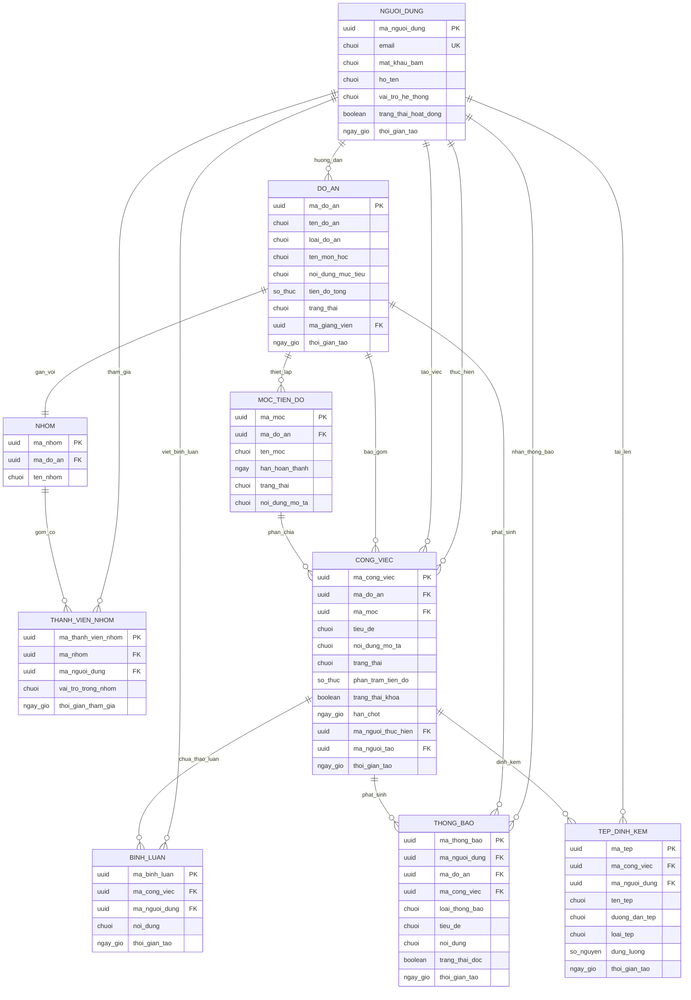

# Sơ đồ Thực thể Mối quan hệ (ERD - Sau chuẩn hóa)

> **Cách xem sơ đồ:** Xem trực tiếp trên giao diện GitHub hoặc sao chép mã dán vào trang [Mermaid Live Editor](https://mermaid.live).  
> **Quy chuẩn danh pháp:** 100% tên thực thể và tên thuộc tính đều sử dụng **Danh từ** hoặc **Cụm danh từ**.

---

## Ghi chú các ràng buộc toàn vẹn và ánh xạ vật lý
1. **Quan hệ 1–1 giữa Đồ án và Nhóm:**
   - Trường `NHOM.ma_do_an` có ràng buộc `UNIQUE` và là khóa ngoại tham chiếu tới `DO_AN(ma_do_an)` để đảm bảo mỗi đồ án chỉ gắn với duy nhất 1 nhóm sinh viên (và ngược lại).
2. **Kỹ thuật Denormalization trên thực thể CONG_VIEC:**
   - Thuộc tính `ma_do_an` được lưu trực tiếp trong `CONG_VIEC` (song song với `ma_moc`) nhằm tăng tốc độ truy vấn danh sách công việc theo đồ án mà không phải nối bảng trung gian `MOC_TIEN_DO`. Về mặt lý thuyết chuẩn hóa thuần túy, `CONG_VIEC` chỉ cần thuộc tính `ma_moc` do đã có phụ thuộc hàm `ma_moc → ma_do_an`.
3. **Thực thể hợp nhất NGUOI_DUNG:**
   - Trong mô hình CSDL vật lý, hai thực thể lý thuyết `NGUOI_THUC_HIEN` (sinh viên) và `GIANG_VIEN` được hợp nhất vào bảng dùng chung `NGUOI_DUNG` và phân định bằng thuộc tính `vai_tro_he_thong`.
4. **Ký hiệu trên sơ đồ:**
   - `PK`: Khóa chính (Primary Key).
   - `FK`: Khóa ngoại (Foreign Key).
   - `UK`: Ràng buộc giá trị duy nhất (Unique Key).
