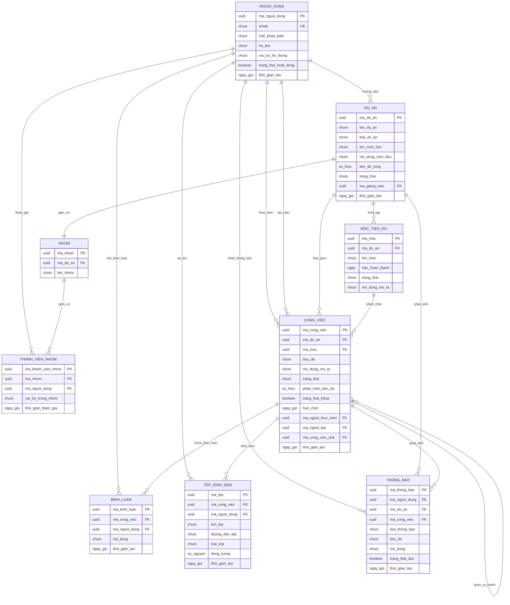

# Sơ đồ Thực thể Mối quan hệ (ERD - Sau chuẩn hóa)

> **Cách xem sơ đồ:** Xem trực tiếp trên giao diện GitHub hoặc sao chép mã dán vào trang [Mermaid Live Editor](https://mermaid.live).  
> **Quy chuẩn danh pháp:** 100% tên thực thể và tên thuộc tính đều sử dụng **Danh từ** hoặc **Cụm danh từ**.

---

## Ghi chú các ràng buộc toàn vẹn
1. **Khóa ngoại và Ràng buộc duy nhất:**
   - Trường `NHOM.ma_do_an` có ràng buộc `UNIQUE` để bảo đảm mỗi đồ án chỉ có đúng 1 nhóm sinh viên thực hiện (quan hệ 1–1).
   - Bảng `THANH_VIEN_NHOM` có ràng buộc duy nhất trên cặp `(ma_nhom, ma_nguoi_dung)` để tránh trùng lặp sinh viên trong cùng một nhóm.
2. **Ký hiệu trên sơ đồ:**
   - `PK`: Khóa chính (Primary Key).
   - `FK`: Khóa ngoại (Foreign Key).
   - `UK`: Ràng buộc giá trị duy nhất (Unique Key).
