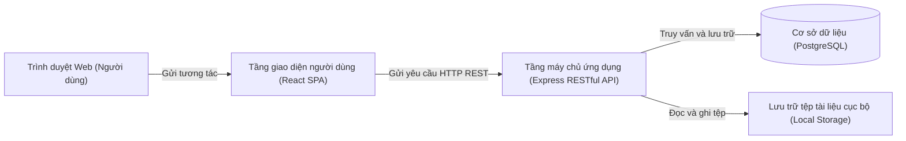

# Kiến trúc Hệ thống (Dự kiến)

> **Cách xem sơ đồ:** Xem trên giao diện GitHub hoặc sao chép mã dán vào trang [Mermaid Live Editor](https://mermaid.live).  
> **Quy chuẩn thiết kế:** Tương tác trên sơ đồ kiến trúc sử dụng **Động từ hành động** mô tả luồng dữ liệu giữa các phân tầng.

## Các thành phần trong kiến trúc
| Phân tầng kiến trúc | Công nghệ sử dụng | Nhiệm vụ chính trong hệ thống |
|---|---|---|
| **Tầng hiển thị (Presentation Layer)** | React SPA, Vite, Chart.js / ECharts | Xây dựng giao diện web động, trực quan hóa biểu đồ tiến độ theo vai trò người dùng |
| **Tầng nghiệp vụ (Application Layer)** | Node.js + Express.js | Xử lý xác thực JWT, kiểm tra phân quyền (RBAC), điều phối luồng nghiệp vụ công việc và thông báo |
| **Tầng dữ liệu (Data Layer)** | Hệ quản trị CSDL PostgreSQL | Lưu trữ và bảo đảm tính toàn vẹn cho dữ liệu đã chuẩn hóa (3NF/BCNF) |
| **Tầng lưu trữ tệp (File Storage)** | Thư mục cục bộ máy chủ (`uploads/`) | Lưu trữ tệp tài liệu, biên bản và sản phẩm đính kèm của đồ án trong phiên bản MVP |

## Nguyên tắc thiết kế kiến trúc
1. Tầng giao diện (Frontend) hoàn toàn không truy cập trực tiếp vào Cơ sở dữ liệu; mọi tương tác đều phải thông qua giao thức HTTP REST API.
2. Mọi yêu cầu gọi API nghiệp vụ đều bắt buộc phải qua middleware xác thực danh tính (Authentication) và kiểm tra quyền hạn (Authorization).
3. Tiến trình kiểm tra công việc quá hạn (Trễ hạn) được kích hoạt định kỳ hoặc tự động kiểm tra mỗi khi người dùng tải danh sách công việc.
