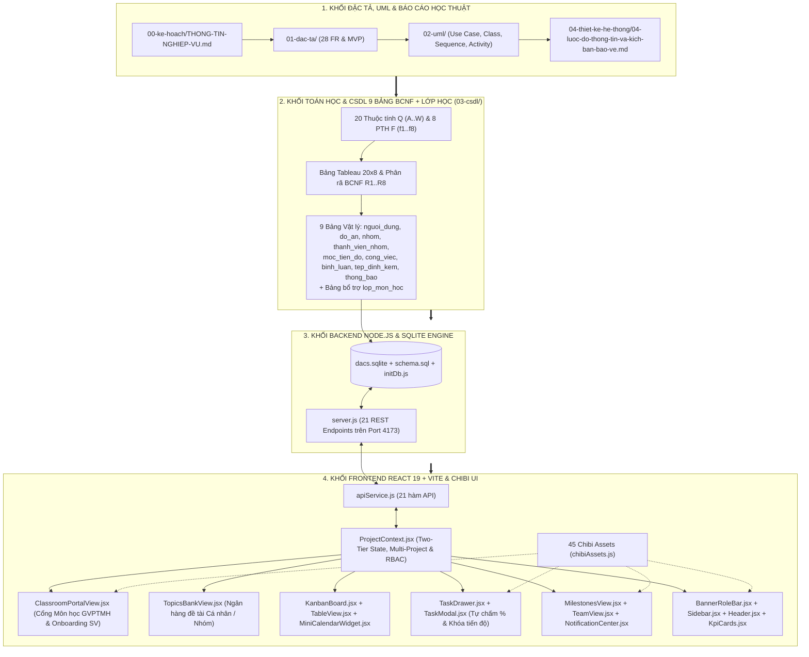

# 🌳 HỆ THỐNG CÂY LIÊN KẾT THÔNG TIN DỰ ÁN (PROJECT KNOWLEDGE & LINK TREES)

> [!IMPORTANT]
> **QUY TẮC BẮT BUỘC TOÀN HỆ THỐNG (MANDATORY SYNC RULE):**  
> Tài liệu này là **Bản đồ Trung tâm (Single Source of Truth Map)** kết nối toàn bộ Chức năng, Cơ sở dữ liệu BCNF, Backend API, Frontend Components, Tài nguyên Chibi và Tài liệu học thuật của dự án **Hệ thống quản lý công việc và tiến độ đồ án môn học**.  
> **Khi bất kỳ thành viên nào hoặc AI Agent cập nhật dự án ở bất kỳ dạng nào** (thêm/sửa/xóa code, API, bảng CSDL, hình ảnh, hay tài liệu báo cáo), **BẮT BUỘC phải cập nhật đồng bộ vào các Cây Liên kết tương ứng và Cây Liên kết Tổng hợp ở cuối file này.**

---

## Mục lục Hệ thống Cây Liên kết

1. [Cây 1: Cây Liên kết Rút gọn (Quick Navigation Tree)](#1-cây-1-cây-liên-kết-rút-gọn-quick-navigation-tree)
2. [Cây 2: Cây Liên kết Chức năng & Nghiệp vụ (Functional Link Tree)](#2-cây-2-cây-liên-kết-chức-năng--nghiệp-vụ-functional-link-tree)
3. [Cây 3: Cây Liên kết Cơ sở dữ liệu & Chuẩn hóa BCNF (Database Link Tree)](#3-cây-3-cây-liên-kết-cơ-sở-dữ-liệu--chuẩn-hóa-bcnf-database-link-tree)
4. [Cây 4: Cây Liên kết Kiến trúc Hệ thống & API Fullstack (System & API Link Tree)](#4-cây-4-cây-liên-kết-kiến-trúc-hệ-thống--api-fullstack-system--api-link-tree)
5. [Cây 5: Cây Liên kết Giao diện & Tài nguyên Chibi (UI/UX & Assets Link Tree)](#5-cây-5-cây-liên-kết-giao-diện--tài-nguyên-chibi-uiux--assets-link-tree)
6. [Cây 6: Cây Liên kết Hồ sơ Báo cáo & Phản biện Hội đồng (Academic Defense Tree)](#6-cây-6-cây-liên-kết-hồ-sơ-báo-cáo--phản-biện-hội-đồng-academic-defense-tree)
7. [Cây 7 (CÂY CUỐI): CÂY LIÊN KẾT TỔNG HỢP TOÀN HỆ THỐNG (Grand Master Unified Link Tree)](#7-cây-7-cây-cuối-cây-liên-kết-tổng-hợp-toàn-hệ-thống-grand-master-unified-link-tree)

---

## 1. Cây 1: Cây Liên kết Rút gọn (Quick Navigation Tree)

*Dành cho thành viên nhóm và Giảng viên hướng dẫn tra cứu nhanh các điểm chạm cốt lõi nhất của dự án:*

```text
📦 HỆ THỐNG QUẢN LÝ CÔNG VIỆC VÀ TIẾN ĐỘ ĐỒ ÁN MÔN HỌC (RÚT GỌN)
├── 🚀 Khởi chạy nhanh: [run_demo.bat](../run_demo.bat) ──> Chạy Fullstack tại http://localhost:4173
├── 📜 Quy tắc bắt buộc (Rules): [AGENTS.md](./AGENTS.md) & [.agents/rules/cay-lien-ket.md](../.agents/rules/cay-lien-ket.md)
├── 📋 Chốt nghiệp vụ gốc: [00-ke-hoach/THONG-TIN-NGHIEP-VU.md](./00-ke-hoach/THONG-TIN-NGHIEP-VU.md)
├── 📌 Phân công Task Nhóm (TDMHorizon & Sixduy): [00-ke-hoach/PHAN-CONG-TASK-NHOM.md](./00-ke-hoach/PHAN-CONG-TASK-NHOM.md)
├── 🎯 Đặc tả 28 Yêu cầu (FR): [01-dac-ta/03-yeu-cau-chuc-nang.md](./01-dac-ta/03-yeu-cau-chuc-nang.md)
├── 📐 Sơ đồ UML (Use Case, Class, Sequence, Activity): [02-uml/](./02-uml/)
├── 🗄️ CSDL 9 Bảng BCNF & Tableau 20x8: [03-csdl/07-schema-sql-du-kien.md](./03-csdl/07-schema-sql-du-kien.md)
├── 🗺️ Lược đồ Thông tin & Kịch bản Bảo vệ: [04-thiet-ke-he-thong/04-luoc-do-thong-tin-va-kich-ban-bao-ve.md](./04-thiet-ke-he-thong/04-luoc-do-thong-tin-va-kich-ban-bao-ve.md)
└── 💻 Mã nguồn Fullstack (React 19 + Node.js + SQLite): [07-nguon-code/demo-giao-dien/](./07-nguon-code/demo-giao-dien/)
    ├── ⚙️ Backend API & SQLite Server: [server.js](./07-nguon-code/demo-giao-dien/server.js) (28 REST Endpoints + GitHub Sync/Cache + Upload `/uploads/`)
    ├── 🌱 Khởi tạo & Seed 9 bảng BCNF + Lớp môn học + GitHub: [src/db/initDb.js](./07-nguon-code/demo-giao-dien/src/db/initDb.js)
    ├── 🧠 Quản lý State, Auth & Hai Tầng Trải nghiệm: [src/context/ProjectContext.jsx](./07-nguon-code/demo-giao-dien/src/context/ProjectContext.jsx)
    └── 🎨 16 Giao diện Components & Cấu hình: [src/components/](./07-nguon-code/demo-giao-dien/src/components/)
        ├── 🔐 Đăng nhập & Đổi tài khoản (`@gmail.com`): [LoginScreen.jsx](./07-nguon-code/demo-giao-dien/src/components/LoginScreen.jsx)
        ├── 🏫 Cổng Môn học Tinh giản GVPTMH & Sinh viên: [ClassroomPortalView.jsx](./07-nguon-code/demo-giao-dien/src/components/ClassroomPortalView.jsx)
        ├── 🐙 Dashboard Tiến độ GitHub (Commits, PRs, Push): [GitHubDashboardView.jsx](./07-nguon-code/demo-giao-dien/src/components/GitHubDashboardView.jsx)
        ├── 🧭 Khung Hướng dẫn Sử dụng (Dài hạn - Chờ chốt): [guideConfig.js](./07-nguon-code/demo-giao-dien/src/constants/guideConfig.js)
        └── 🚀 Không gian Chi tiết Workspace: [KanbanBoard.jsx](./07-nguon-code/demo-giao-dien/src/components/KanbanBoard.jsx) + [TaskDrawer.jsx](./07-nguon-code/demo-giao-dien/src/components/TaskDrawer.jsx)
```

---

## 2. Cây 2: Cây Liên kết Chức năng & Nghiệp vụ (Functional Link Tree)

*Liên kết xuyên suốt từ **Yêu cầu nghiệp vụ** $\rightarrow$ **Tài liệu Đặc tả / UML** $\rightarrow$ **Giao diện React Component** $\rightarrow$ **Context Action** $\rightarrow$ **Backend API & Bảng CSDL**:*

```text
🎯 CÂY LIÊN KẾT CHỨC NĂNG NGHIỆP VỤ (END-TO-END FUNCTIONAL TRACEABILITY)
│
├── 1️⃣ ĐĂNG NHẬP, PHÂN QUYỀN 4 VAI TRÒ & CHUYỂN ĐỔI GÓC NHÌN (AUTH & RBAC)
│   ├── Đặc tả: [FR-01..FR-04](./01-dac-ta/03-yeu-cau-chuc-nang.md) & [06-actor-vai-tro.md](./01-dac-ta/06-actor-vai-tro.md)
│   ├── Giao diện: [LoginScreen.jsx](./07-nguon-code/demo-giao-dien/src/components/LoginScreen.jsx) (Đăng nhập `@gmail.com` / chọn nhanh 4 tài khoản) + [BannerRoleBar.jsx](./07-nguon-code/demo-giao-dien/src/components/BannerRoleBar.jsx) (Hiển thị người dùng, Đổi tài khoản & Đăng xuất)
│   ├── Logic Context: `authUser`, `login()`, `logout()`, `currentUser`, `isLecturer`, `isLeader`, `isMember` trong [ProjectContext.jsx](./07-nguon-code/demo-giao-dien/src/context/ProjectContext.jsx)
│   └── API & CSDL: `POST /api/auth/login` & `GET /api/users` ([server.js](./07-nguon-code/demo-giao-dien/server.js)) ──> Bảng `nguoi_dung` + `thanh_vien_nhom`
│
├── 2️⃣ QUẢN LÝ LỚP HỌC PHẦN, NGÂN HÀNG ĐỀ TÀI & PHÂN TẦNG TRẢI NGHIỆM (TWO-TIER ARCHITECTURE)
│   ├── Đặc tả: [FR-05..FR-08](./01-dac-ta/03-yeu-cau-chuc-nang.md) & [04-luoc-do-thong-tin-va-kich-ban-bao-ve.md](./04-thiet-ke-he-thong/04-luoc-do-thong-tin-va-kich-ban-bao-ve.md)
│   ├── 🏛️ TẦNG 1 — CỔNG MÔN HỌC & ONBOARDING: [ClassroomPortalView.jsx](./07-nguon-code/demo-giao-dien/src/components/ClassroomPortalView.jsx)
│   │   ├── [Góc nhìn GVPTMH]: Quản lý Lớp học phần (`GET /api/classes`, `POST /api/classes`), Ngân hàng đề tài, Xóa đề tài (`DELETE /api/topics/:id`), Giám sát tiến độ tổng các nhóm & Nút "Đi vào Kanban nhóm"
│   │   ├── [Góc nhìn Sinh viên chưa có nhóm]: Thẻ lựa chọn tinh gọn (Đề tài 1 SV chỉ hiển thị `⚡ Xác nhận nhận đề tài` - Modal C; Đề tài nhóm mở Modal Lập nhóm D; Sinh viên đã có nhóm tự động bị làm mờ và khóa chọn)
│   │   ├── [Góc nhìn Sinh viên đã có nhóm]: Thẻ tổng quan đồ án đang làm & Lưới Ngân hàng Đề tài tương tác đầy đủ (Huy hiệu `⭐ ĐỀ TÀI CỦA BẠN`, xem tiến độ các nhóm bạn, nút `Đi vào Bảng việc Kanban` trực tiếp trên từng đề tài)
│   ├── 🚀 TẦNG 2 — KHÔNG GIAN CHI TIẾT WORKSPACE: Chỉ mở ra khi chọn cụ thể 1 nhóm/đề tài (Kanban, Table, Milestones)
│   │   ├── [Nhánh 2A - Giảng viên tạo đề tài]: Modal Tạo Đề tài Đa năng (Task B2 & B4: Nhập danh sách động, Dán hàng loạt, và Tab "📊 Import từ Excel / CSV" với parser `xlsx`, ánh xạ cột Tên đề tài/Mô tả/Số lượng SV, Preview trước khi công bố; Thiết lập quy mô linh hoạt 1..50 SV với nút tăng/giảm quy mô nhanh `[-]`/`[+]`; Cung cấp file test mẫu [danh-sach-de-tai-mau.xlsx](./test-data/danh-sach-de-tai-mau.xlsx)) ──> `POST /api/topics` (Batch/Single)
│   │   ├── [Nhánh 2B - Sinh viên chọn Đề tài Cá nhân]: Modal C Xác nhận ──> Tự động gán sinh viên đăng nhập thực hiện (đã loại bỏ dropdown chọn SV), hiển thị thông tin cố định và khóa nếu đã có nhóm ──> `POST /api/topics/:id/register-solo` ──> Gán `nhom_truong`
│   │   ├── [Nhánh 2C - Sinh viên Lập Nhóm & Đăng ký]: Đặt tên nhóm, chọn thành viên linh hoạt theo giới hạn đề tài, phân nhóm trưởng; Chặn & làm mờ SV đã có nhóm trong lớp (`ten_mon_hoc`) kèm nhãn `🔒 Đã thuộc [Tên nhóm]` ──> `POST /api/topics/:id/register-team`
│   │   └── [Nhánh 2D - Đặt lại trạng thái đề tài trống]: Nút "Đặt lại trống" ──> `POST /api/topics/:id/reset`
│   └── Điều hướng 2 chiều: Nút `🏫 ← Quay lại Cổng Môn học` trên [Sidebar.jsx](./07-nguon-code/demo-giao-dien/src/components/Sidebar.jsx) & [Header.jsx](./07-nguon-code/demo-giao-dien/src/components/Header.jsx)
│
├── 3️⃣ QUẢN LÝ MỐC TIẾN ĐỘ (MILESTONES) & LỊCH TRÌNH
│   ├── Đặc tả: [FR-09..FR-11](./01-dac-ta/03-yeu-cau-chuc-nang.md)
│   ├── Giao diện:
│   │   ├── Danh sách mốc & Bản đồ lộ trình: [MilestonesView.jsx](./07-nguon-code/demo-giao-dien/src/components/MilestonesView.jsx) (Con dấu đỏ `label-approved.png` cho mốc hoàn thành 100%)
│   │   ├── Bộ lọc theo mốc trên Header: [Header.jsx](./07-nguon-code/demo-giao-dien/src/components/Header.jsx)
│   │   └── Lịch thu nhỏ & Cảnh báo hạn chót: [MiniCalendarWidget.jsx](./07-nguon-code/demo-giao-dien/src/components/MiniCalendarWidget.jsx)
│   └── API & CSDL: `GET /api/milestones?projectId=:id` ──> Bảng `moc_tien_do` JOIN `cong_viec`
│
├── 4️⃣ QUẢN LÝ CÔNG VIỆC (KANBAN & TABLE), TỰ CHẤM % TIẾN ĐỘ & KHÓA TIẾN ĐỘ
│   ├── Đặc tả: [FR-12..FR-20](./01-dac-ta/03-yeu-cau-chuc-nang.md) & [04-sequence-diagram.md](./02-uml/04-sequence-diagram.md)
│   ├── Giao diện:
│   │   ├── Bảng kéo/xem 4 cột trạng thái: [KanbanBoard.jsx](./07-nguon-code/demo-giao-dien/src/components/KanbanBoard.jsx) (`can_lam`, `dang_lam`, `hoan_thanh`, `tre_han`)
│   │   ├── Bảng danh sách chi tiết: [TableView.jsx](./07-nguon-code/demo-giao-dien/src/components/TableView.jsx)
│   │   ├── Modal Giao việc mới (GVHD / Nhóm trưởng): [TaskModal.jsx](./07-nguon-code/demo-giao-dien/src/components/TaskModal.jsx)
│   │   └── Ngăn trượt chi tiết & Tự chấm tiến độ (0%-100%): [TaskDrawer.jsx](./07-nguon-code/demo-giao-dien/src/components/TaskDrawer.jsx)
│   ├── Logic Context:
│   │   ├── Giao việc: `createTask()` ──> `POST /api/tasks`
│   │   ├── Tự chấm tiến độ: `selfRateTask()` & `updateTaskProgress()` ──> `PATCH /api/tasks/:id`
│   │   └── Khóa / Mở khóa tiến độ (GVHD & Nhóm trưởng): `toggleTaskLock()` ──> `POST /api/tasks/:id/lock` & `/unlock`
│   └── Tự động tính % tổng đồ án: `recalculateProjectProgress(projectId)` trong [server.js](./07-nguon-code/demo-giao-dien/server.js) ──> Cập nhật `do_an.tien_do_tong`
│
├── 5️⃣ BÌNH LUẬN TRAO ĐỔI (KÈM STICKER CHIBI) & NỘP TỆP ĐÍNH KÈM THỰC TẾ
│   ├── Đặc tả: [FR-21..FR-22](./01-dac-ta/03-yeu-cau-chuc-nang.md)
│   ├── Giao diện: Khu vực Thảo luận & Tệp nộp thực tế (chọn file từ máy $\le$ 25MB, tải về, xóa) bên trong [TaskDrawer.jsx](./07-nguon-code/demo-giao-dien/src/components/TaskDrawer.jsx)
│   └── API & CSDL:
│       ├── `GET/POST /api/tasks/:id/comments` ──> Bảng `binh_luan`
│       └── `GET/POST /api/tasks/:id/attachments`, `DELETE /api/attachments/:id`, `GET /uploads/...` ──> Bảng `tep_dinh_kem` + Thư mục `uploads/`
│
├── 6️⃣ THÔNG BÁO HỆ THỐNG & DASHBOARD TIẾN ĐỘ TRỰC QUAN
│   ├── Đặc tả: [FR-23..FR-28](./01-dac-ta/03-yeu-cau-chuc-nang.md)
│   ├── Giao diện:
│   │   ├── 4 Thẻ chỉ số KPI (Có watermark Chibi 3D): [KpiCards.jsx](./07-nguon-code/demo-giao-dien/src/components/KpiCards.jsx)
│   │   ├── Đường đua Tiến độ Chibi Marathon trên Header: [Header.jsx](./07-nguon-code/demo-giao-dien/src/components/Header.jsx)
│   │   ├── Hồ sơ Thành viên & GVHD (Hero Character Cards): [TeamView.jsx](./07-nguon-code/demo-giao-dien/src/components/TeamView.jsx)
│   │   └── Trung tâm Thông báo: [NotificationCenter.jsx](./07-nguon-code/demo-giao-dien/src/components/NotificationCenter.jsx)
│   └── API & CSDL: `GET /api/notifications?userId=:id` ──> Bảng `thong_bao`
│
└── 7️⃣ KẾT NỐI GITHUB DASHBOARD, TINH GIẢN CỔNG LỚP & KHUNG HƯỚNG DẪN DÀI HẠN
    ├── Phân công Nhóm: [PHAN-CONG-TASK-NHOM.md](./00-ke-hoach/PHAN-CONG-TASK-NHOM.md) (Phần 1: TDMHorizon · Phần 2: Sixduy — Đã review & hợp nhất PR #3)
    ├── Giao diện Tinh giản Cổng Lớp & Sidebar (Task A0 + Bổ sung): [ClassroomPortalView.jsx](./07-nguon-code/demo-giao-dien/src/components/ClassroomPortalView.jsx) & [Sidebar.jsx](./07-nguon-code/demo-giao-dien/src/components/Sidebar.jsx) (Sidebar bỏ danh sách nhóm trùng lặp; GV 1 dòng tóm tắt lớp + 1 Bảng Tổng hợp duy nhất; SV 1 Thẻ trạng thái + Modal Chi tiết)
    ├── Quy tắc Thành viên & Import Excel (Task B2, B3, B4, B5 — Chuẩn hóa sau PR #3): [ClassroomPortalView.jsx](./07-nguon-code/demo-giao-dien/src/components/ClassroomPortalView.jsx) & [server.js](./07-nguon-code/demo-giao-dien/server.js) (Min = 1 & Max = Không giới hạn/tùy chọn qua `getTopicScaleInfo`, Chặn & làm mờ SV đã có nhóm qua `assignedStudentMap`, Xóa đề tài `DELETE /api/topics/:id` trong Modal Chi tiết, Import Excel/CSV `xlsx` hỗ trợ 3 cột ánh xạ, gắn neo tour `data-tour-id`)
    ├── Dashboard Tiến độ GitHub (Task A2): [GitHubDashboardView.jsx](./07-nguon-code/demo-giao-dien/src/components/GitHubDashboardView.jsx) (Dòng thời gian Commit, Push theo thành viên, Pull Requests, Branches)
    ├── Khung Hướng dẫn Sử dụng Dài hạn (Task A3, B5): [guideConfig.js](./07-nguon-code/demo-giao-dien/src/constants/guideConfig.js) (`REGISTERED_TOUR_TARGETS` gắn các neo DOM `data-tour-id`)
    └── API & CSDL Phụ trợ (Task A1): `GET/POST/DELETE /api/github/*` ──> Bảng phụ trợ `lien_ket_github` (Cache JSON + Ánh xạ GitHub Username, giữ nguyên 9 bảng BCNF)
```

---

## 3. Cây 3: Cây Liên kết Cơ sở dữ liệu & Chuẩn hóa BCNF (Database Link Tree)

*Liên kết chặt chẽ từ **Lý thuyết Toán học (20 thuộc tính, 8 phụ thuộc hàm)** $\rightarrow$ **Chứng minh BCNF & Tableau $20 \times 8$** $\rightarrow$ **9 Bảng Vật lý SQLite/PostgreSQL** $\rightarrow$ **Nơi truy vấn thực tế**:*

```text
🗄️ CÂY LIÊN KẾT CƠ SỞ DỮ LIỆU & CHỨNG MINH TOÁN HỌC BCNF
│
├── 📐 TẦNG 1: PHÂN TÍCH LÝ THUYẾT & CHỨNG MINH TOÁN HỌC ([03-csdl/](./03-csdl/))
│   ├── 1. Tập 20 thuộc tính Q = {A..W}: [01-phan-tich-du-lieu.md](./03-csdl/01-phan-tich-du-lieu.md)
│   ├── 2. Tập 8 phụ thuộc hàm F = {f1..f8}, Phủ tối thiểu Fc & Bao đóng khóa k = {A}: [02-phu-thuoc-ham.md](./03-csdl/02-phu-thuoc-ham.md)
│   ├── 3. Phân rã đạt chuẩn 1NF -> 2NF -> 3NF -> BCNF (R1..R8): [03-chuan-hoa.md](./03-csdl/03-chuan-hoa.md)
│   ├── 4. Bảng Tableau 20x8 (Thuật toán Chase chứng minh không mất mát thông tin): [04-bao-toan-thong-tin.md](./03-csdl/04-bao-toan-thong-tin.md)
│   ├── 5. Chứng minh Bảo toàn toàn bộ 8 phụ thuộc hàm F: [05-bao-toan-phu-thuoc.md](./03-csdl/05-bao-toan-phu-thuoc.md)
│   ├── 6. Sơ đồ Thực thể Kết hợp (ERD): [06-erd.md](./03-csdl/06-erd.md) & [erd.drawio](../erd.drawio)
│   └── 7. Bản giải tay chi tiết & Kịch bản phản biện CSDL: [08-ket-qua-tinh-toan-viet-tay.md](./03-csdl/08-ket-qua-tinh-toan-viet-tay.md) & [KICH-BAN-TRA-LOI-PHAN-BIEN-CSDL.md](../KICH-BAN-TRA-LOI-PHAN-BIEN-CSDL.md)
│
└── 💾 TẦNG 2: 9 BẢNG VẬT LÝ (DDL: [07-schema-sql-du-kien.md](./03-csdl/07-schema-sql-du-kien.md) | SQLite: [schema.sql](./07-nguon-code/demo-giao-dien/src/db/schema.sql))
    ├── Bảng 1: `nguoi_dung` (Tích hợp R4, R5, R7: P->S,T; T->P; K->L)
    │   ├── Khóa chính: `ma_nguoi_dung` | Unique: `email`
    │   └── Dữ liệu mẫu ([initDb.js](./07-nguon-code/demo-giao-dien/src/db/initDb.js)): `u-gv-01` (GVHD) + 5 Sinh viên (`u-sv-01`..`u-sv-05`)
    ├── Bảng 2: `do_an` (Quan hệ R2: H -> I, J, K)
    │   ├── Khóa chính: `ma_do_an` | Khóa ngoại: `ma_giang_vien` -> `nguoi_dung`
    │   └── Biểu diễn Ngân hàng đề tài: Lưu siêu dữ liệu trong `noi_dung_muc_tieu` (Đề tài Tự động nâng/hạ quy mô `[SL: 1-N]`, `[NHÓM 2-3 SV]`, hoặc Đề tài Cá nhân `[CÁ NHÂN 1 SV]`) bảo toàn nguyên vẹn 9 bảng BCNF
    ├── Bảng 3: `nhom` (Quan hệ R3: M -> N, H và H -> M)
    │   ├── Khóa chính: `ma_nhom` | Khóa ngoại Unique (1-1): `ma_do_an` -> `do_an`
    │   └── Quy ước trạng thái: Chưa có dòng trong `nhom` = Đề tài đang mở đăng ký; Có dòng = Đã nhận đề tài
    ├── Bảng 4: `thanh_vien_nhom` (Quan hệ R8: M, P -> R)
    │   ├── Khóa chính: `ma_thanh_vien_nhom` | Unique: `(ma_nhom, ma_nguoi_dung)`
    │   └── Vai trò `vai_tro_trong_nhom`: `'nhom_truong'` (1 người cho cả nhóm hoặc đề tài cá nhân) | `'thanh_vien'`
    ├── Bảng 5: `moc_tien_do` (Quan hệ R6: U -> V, H)
    │   ├── Khóa chính: `ma_moc` | Khóa ngoại: `ma_do_an` -> `do_an`
    │   └── Lưu các cột mốc bàn giao của từng đồ án
    ├── Bảng 6: `cong_viec` (Quan hệ trung tâm R1: A -> B, C, D, E, G, P, U, W)
    │   ├── Khóa chính: `ma_cong_viec` | Khóa ngoại: `ma_do_an`, `ma_moc`, `ma_nguoi_thuc_hien`, `ma_nguoi_tao`, `ma_nguoi_khoa`
    │   └── Cờ bảo mật tiến độ: `trang_thai_khoa` (0 = Mở, 1 = Đã chốt khóa bởi GVHD/Nhóm trưởng)
    ├── Bảng 7: `binh_luan` (Bảng nghiệp vụ mở rộng)
    │   └── Khóa chính: `ma_binh_luan` | Khóa ngoại: `ma_cong_viec`, `ma_nguoi_dung` (Hỗ trợ nhúng `[sticker:id]`)
    ├── Bảng 8: `tep_dinh_kem` (Bảng nghiệp vụ mở rộng)
    │   └── Khóa chính: `ma_tep` | Khóa ngoại: `ma_cong_viec`, `ma_nguoi_dung`
    ├── Bảng 9: `thong_bao` (Bảng nghiệp vụ mở rộng)
    │   └── Khóa chính: `ma_thong_bao` | Khóa ngoại: `ma_nguoi_dung`, `ma_do_an`, `ma_cong_viec`
    └── 🏛️ Bảng bổ trợ: `lop_mon_hoc` (Phục vụ Cổng Môn học GVPTMH & Lớp học phần)
        ├── Khóa chính: `ma_lop` | Khóa ngoại: `ma_giang_vien` -> `nguoi_dung`
        └── Dữ liệu lớp thực tế: `21DTHC5` (Lớp 21DTHC5 - CNPM) & `22DTHE9` (Lớp 22DTHE9 - CNPM)
```

---

## 4. Cây 4: Cây Liên kết Kiến trúc Hệ thống & API Fullstack (System & API Link Tree)

*Liên kết luồng gọi hàm từ **Frontend Service** $\rightarrow$ **HTTP REST Endpoint** $\rightarrow$ **Hàm xử lý SQLite Backend**:*

```text
⚙️ CÂY LIÊN KẾT KIẾN TRÚC FULLSTACK & ENDPOINT API
│
├── 🌐 TẦNG FRONTEND SERVICE: [src/services/apiService.js](./07-nguon-code/demo-giao-dien/src/services/apiService.js)
│   ├── `login(email, matKhau)`         ───> `POST /api/auth/login` (Đăng nhập `@gmail.com`)
│   ├── `getClasses()`                  ───> `GET  /api/classes` (Danh sách lớp học phần)
│   ├── `createClass(data)`             ───> `POST /api/classes` (GVPTMH tạo lớp mới)
│   ├── `getProject(projectId)`         ───> `GET  /api/project?projectId=:id`
│   ├── `getUsers(projectId)`           ───> `GET  /api/users?projectId=:id`
│   ├── `getTopics()`                   ───> `GET  /api/topics`
│   ├── `createTopic(data)`             ───> `POST /api/topics` (Hỗ trợ tạo đơn lẻ hoặc danh sách mảng nhiều đề tài cùng lúc)
│   ├── `deleteTopic(id)`               ───> `DELETE /api/topics/:id` (Xóa cascade đề tài, nhóm, công việc, bình luận, file đính kèm, thông báo liên quan)
│   ├── `registerSoloTopic(id, userId)` ───> `POST /api/topics/:id/register-solo`
│   ├── `registerTeamTopic(id, data)`   ───> `POST /api/topics/:id/register-team`
│   ├── `resetTopicRegistration(id)`    ───> `POST /api/topics/:id/reset`
│   ├── `getMilestones(projectId)`      ───> `GET  /api/milestones?projectId=:id`
│   ├── `getTasks(params)`              ───> `GET  /api/tasks?projectId=:id&milestoneId=...`
│   ├── `createTask(data)`              ───> `POST /api/tasks`
│   ├── `updateTask(taskId, data)`      ───> `PATCH /api/tasks/:id`
│   ├── `lockTask(taskId, userId)`      ───> `POST /api/tasks/:id/lock`
│   ├── `unlockTask(taskId)`            ───> `POST /api/tasks/:id/unlock`
│   ├── `getComments(taskId)`           ───> `GET  /api/tasks/:id/comments`
│   ├── `addComment(taskId, data)`      ───> `POST /api/tasks/:id/comments`
│   ├── `getAttachments(taskId)`        ───> `GET  /api/tasks/:id/attachments`
│   ├── `addAttachment(taskId, data)`   ───> `POST /api/tasks/:id/attachments` (Upload file base64 thực xuống `uploads/`)
│   ├── `deleteAttachment(fileId)`      ───> `DELETE /api/attachments/:id` (Xóa file thực & bản ghi CSDL)
│   ├── `getTeam(projectId)`            ───> `GET  /api/team?projectId=:id`
│   ├── `getNotifications(userId)`      ───> `GET  /api/notifications?userId=:id`
│   ├── `getGithubDashboard(projectId)` ───> `GET  /api/github/dashboard?projectId=:id`
│   ├── `connectGithub(payload)`        ───> `POST /api/github/connect`
│   ├── `syncGithub(projectId, token)`  ───> `POST /api/github/sync`
│   ├── `saveGithubMapping(id, map)`    ───> `POST /api/github/mapping`
│   └── `disconnectGithub(projectId)`   ───> `DELETE /api/github/connect?projectId=:id`
│
├── 🗄️ CSDL Phụ trợ GitHub: Bảng `lien_ket_github` (Cache JSON Snapshot + Mapping Thành viên; giữ nguyên 9 bảng chuẩn BCNF)
│
├── 🖥️ TẦNG BACKEND SERVER: [server.js](./07-nguon-code/demo-giao-dien/server.js) (Node.js HTTP + `node:sqlite`, 29 REST Endpoints Port 4173)
│   ├── `recalculateProjectProgress(projectId)` (Tự động tính `AVG(phan_tram_tien_do)` cập nhật vào `do_an.tien_do_tong`)
│   ├── `parseTopicMeta(noiDung)` (Phân tích nhãn `[CÁ NHÂN 1 SV]` / `[NHÓM 2-3 SV]` không phá vỡ schema BCNF)
│   ├── `parseGithubRepoUrl` / `fetchGithubSnapshot` / `buildGithubDashboardResponse` (Đồng bộ & Cache JSON GitHub REST API + Mapping `GitHub Username ↔ Thành viên`)
│   ├── Lưu & Phục vụ file đính kèm thực (`/uploads/...`) trong thư mục cục bộ `uploads/`
│   ├── Phục vụ tĩnh (Static File Server) từ `dist/` kết hợp fallback tìm kiếm tự động trong `public/`
│   └── Cơ chế bảo vệ tài nguyên ảnh/css/js: Chặn trả về `index.html` cho file tĩnh lỗi (tránh lưu cache HTML gây vỡ ảnh)
│
└── 💽 TẦNG PERSISTENCE (LƯU TRỮ CỤC BỘ):
    ├── File CSDL nhị phân: [dacs.sqlite](./07-nguon-code/demo-giao-dien/dacs.sqlite) (Chuẩn hóa tên đề tài `Hệ thống quản lý công việc và tiến độ đồ án môn học`)
    ├── Script tạo bảng & seed: [src/db/initDb.js](./07-nguon-code/demo-giao-dien/src/db/initDb.js) (9 Bảng BCNF + Bảng phụ trợ `lop_mon_hoc`, `lien_ket_github`)
    └── Bản sao dữ liệu mẫu đối chiếu: [src/data/databaseMock.js](./07-nguon-code/demo-giao-dien/src/data/databaseMock.js)
```

---

## 5. Cây 5: Cây Liên kết Giao diện & Tài nguyên Chibi (UI/UX & Assets Link Tree)

*Liên kết giữa **45 File hình ảnh Chibi tinh gọn** $\rightarrow$ **Từ điển hằng số `chibiAssets.js`** $\rightarrow$ **Vị trí hiển thị trên 16 Components & Khung Hướng dẫn**:*

```text
🎨 CÂY LIÊN KẾT GIAO DIỆN & 45 TÀI NGUYÊN CHIBI
│
├── 📁 Kho ảnh tĩnh (Đã lọc tinh gọn đúng 45 file): [public/assets/chibi/](./07-nguon-code/demo-giao-dien/public/assets/chibi/)
├── 🗂️ Từ điển ánh xạ đường dẫn: [src/constants/chibiAssets.js](./07-nguon-code/demo-giao-dien/src/constants/chibiAssets.js)
├── 🧭 Khung Hướng dẫn Sử dụng (Dài hạn - Chờ chốt): [src/constants/guideConfig.js](./07-nguon-code/demo-giao-dien/src/constants/guideConfig.js) (`GUIDE_TOUR_ENABLED = false`)
├── 💅 Hệ thống CSS & Tokens: [src/styles/app.css](./07-nguon-code/demo-giao-dien/src/styles/app.css) & [src/styles/tokens.css](./07-nguon-code/demo-giao-dien/src/styles/tokens.css)
│
└── 🧩 ÁNH XẠ VÀO 16 REACT COMPONENTS ([src/components/](./07-nguon-code/demo-giao-dien/src/components/)):
    ├── 0. [LoginScreen.jsx](./07-nguon-code/demo-giao-dien/src/components/LoginScreen.jsx) ──> `logos.gearTick` + Modal Đăng nhập chuẩn TasteSkill nền sáng (`@gmail.com` & 4 nút chọn nhanh vai trò)
    ├── 1. [BannerRoleBar.jsx](./07-nguon-code/demo-giao-dien/src/components/BannerRoleBar.jsx) ──> `logos.gearTick`, `badges.review10`, `badges.leader`, `badges.fresher` + Hiển thị user đăng nhập, Đổi tài khoản, Đăng xuất & Tiêu đề chuẩn hóa `HỆ THỐNG QUẢN LÝ ĐỒ ÁN MÔN HỌC`
    ├── 2. [ClassroomPortalView.jsx](./07-nguon-code/demo-giao-dien/src/components/ClassroomPortalView.jsx) ──> Cổng Môn học Tối giản: GVPTMH (1 dòng tóm tắt lớp + 1 Bảng Tổng hợp duy nhất có lọc nhanh & Modal Chi tiết `MODAL E`, không Chibi/KPI to) & Sinh viên (1 Thẻ trạng thái + Lưới đề tài tối giản + Modal E)
    ├── 3. [Sidebar.jsx](./07-nguon-code/demo-giao-dien/src/components/Sidebar.jsx) ──> Full-bleed Brand Banner (`logos.team`), Cổng Lớp tinh giản (chỉ giữ `Tổng quan Lớp & Đề tài` + `Thông báo hệ thống`, bỏ danh sách nhóm trùng lặp), Tab `🐙 GitHub Tiến độ` (`data-tour-id="tour-nav-github"`), Avatar Frames (`gv`, `leader`, `member`)
    ├── 4. [Header.jsx](./07-nguon-code/demo-giao-dien/src/components/Header.jsx) ──> Nút quay lại Cổng môn học, Đường đua Tiến độ Chibi Marathon (`characters.coLen` -> `coding` -> `deadline` -> `success`) + Cúp đích; Tiêu đề chuẩn `Hệ thống quản lý công việc và tiến độ đồ án môn học`
    ├── 5. [TopicsBankView.jsx](./07-nguon-code/demo-giao-dien/src/components/TopicsBankView.jsx) ──> Banner Lớp học phần nền sáng (`characters.gvReview`), Lưới Đề tài Cá nhân/Nhóm, Modal tạo nhiều đề tài cùng lúc, Modal Lập nhóm & Chọn Nhóm trưởng
    ├── 6. [KpiCards.jsx](./07-nguon-code/demo-giao-dien/src/components/KpiCards.jsx) ──> 4 Thẻ KPI có Watermark Chibi 3D (`chiaTask`, `coding`, `success`, `tieuChay`) + Đếm trễ hạn theo `isTaskOverdue()` + onError Fallback tự phục hồi
    ├── 7. [KanbanBoard.jsx](./07-nguon-code/demo-giao-dien/src/components/KanbanBoard.jsx) ──> 4 cột Kanban, Badge hạn chót (`.task-due-badge`) & tự phân cột trễ hạn thực tế, Empty states (`empty`, `emptyWait`, `boba`), Nhãn `label-chay-deadline`
    ├── 8. [MiniCalendarWidget.jsx](./07-nguon-code/demo-giao-dien/src/components/MiniCalendarWidget.jsx) ──> Lịch tháng thu nhỏ bên trong Kanban + Logo `deadlineFighter`
    ├── 9. [TableView.jsx](./07-nguon-code/demo-giao-dien/src/components/TableView.jsx) ──> Bảng dữ liệu chi tiết kèm thanh tiến độ và trạng thái khóa
    ├── 10. [MilestonesView.jsx](./07-nguon-code/demo-giao-dien/src/components/MilestonesView.jsx) ──> Bản đồ lộ trình (`journey.map`) + Con dấu đỏ nghiệm thu xoay nghiêng (`labels.approved`)
    ├── 11. [TeamView.jsx](./07-nguon-code/demo-giao-dien/src/components/TeamView.jsx) ──> Thẻ Giảng viên & Thẻ Hero Character Profile Cards (`leaderGanhTa`, `coding`)
    ├── 12. [NotificationCenter.jsx](./07-nguon-code/demo-giao-dien/src/components/NotificationCenter.jsx) ──> Hộp thư thông báo (`characters.notify`)
    ├── 13. [TaskDrawer.jsx](./07-nguon-code/demo-giao-dien/src/components/TaskDrawer.jsx) ──> Sân khấu Cảm xúc Chibi theo % tự chấm (0%->100%), Con dấu khóa tiến độ, Bộ 6 Sticker bình luận (`stickers[0..5]`)
    ├── 14. [TaskModal.jsx](./07-nguon-code/demo-giao-dien/src/components/TaskModal.jsx) ──> Popup Giao công việc mới
    └── 15. [GitHubDashboardView.jsx](./07-nguon-code/demo-giao-dien/src/components/GitHubDashboardView.jsx) ──> Dashboard Dòng thời gian Commit theo ngày, Thống kê Push từng thành viên (lọc theo người), Pull Requests, Branches & Cấu hình Mapping GitHub Username
```

---

## 6. Cây 6: Cây Liên kết Hồ sơ Báo cáo & Phản biện Hội đồng (Academic Defense Tree)

*Liên kết phục vụ viết báo cáo Word và bảo vệ trước Hội đồng:*

```text
🎓 CÂY LIÊN KẾT HỒ SƠ BÁO CÁO WORD & PHẢN BIỆN HỘI ĐỒNG
│
├── 📄 Biểu mẫu Word gốc tại thư mục cha:
│   ├── Báo cáo chính: [dacs.doc](../dacs.doc)
│   ├── Phiếu đăng ký: [[1] Phieu dang ky DACS.doc](../[1]%20Phieu%20dang%20ky%20DACS.doc)
│   ├── Phiếu theo dõi tiến độ: [[2] Phieu theo doi tien doDACS.doc](../[2]%20Phieu%20theo%20doi%20tien%20doDACS.doc)
│   ├── Trang bìa: [[3] Trang bia DACS.doc](../[3]%20Trang%20bia%20DACS.doc)
│   └── Hướng dẫn viết báo cáo: [[4] Huong dan viet DACS.doc](../[4]%20Huong%20dan%20viet%20DACS.doc)
│
├── 📊 Chương 1 — Tổng quan & Đặc tả Yêu cầu ([01-dac-ta/](./01-dac-ta/))
│   ├── Ý tưởng & Mục tiêu: [01-y-tuong.md](./01-dac-ta/01-y-tuong.md) & [02-mo-ta-he-thong.md](./01-dac-ta/02-mo-ta-he-thong.md)
│   ├── Yêu cầu chức năng (28 FR) & Phi chức năng (NFR): [03-yeu-cau-chuc-nang.md](./01-dac-ta/03-yeu-cau-chuc-nang.md) & [04-yeu-cau-phi-chuc-nang.md](./01-dac-ta/04-yeu-cau-phi-chuc-nang.md)
│   └── Phạm vi MVP & Tác tử: [05-pham-vi-mvp.md](./01-dac-ta/05-pham-vi-mvp.md) & [06-actor-vai-tro.md](./01-dac-ta/06-actor-vai-tro.md)
│
├── 📐 Chương 2 — Phân tích & Thiết kế UML ([02-uml/](./02-uml/))
│   ├── Đặc tả Use Case & Sơ đồ Use Case: [01-use-case.md](./02-uml/01-use-case.md) & [02-use-case-diagram.md](./02-uml/02-use-case-diagram.md)
│   ├── Sơ đồ Lớp (Class Diagram): [03-class-diagram.md](./02-uml/03-class-diagram.md)
│   ├── Sơ đồ Tuần tự (Sequence Diagram): [04-sequence-diagram.md](./02-uml/04-sequence-diagram.md)
│   └── Sơ đồ Hoạt động (Activity Diagram): [05-activity-diagram.md](./02-uml/05-activity-diagram.md)
│
├── 🧮 Chương 3 — Thiết kế & Chuẩn hóa CSDL BCNF ([03-csdl/](./03-csdl/))
│   └── Toàn bộ 8 file từ `01-phan-tich-du-lieu.md` đến `08-ket-qua-tinh-toan-viet-tay.md`
│
└── 🛡️ Chương 4 & Phụ lục — Kiến trúc, Lược đồ Thông tin & Kịch bản Bảo vệ ([04-thiet-ke-he-thong/](./04-thiet-ke-he-thong/))
    ├── Kiến trúc 3 tầng & REST API: [01-kien-truc.md](./04-thiet-ke-he-thong/01-kien-truc.md) & [02-api-du-kien.md](./04-thiet-ke-he-thong/02-api-du-kien.md)
    ├── Đặc tả màn hình: [03-man-hinh-du-kien.md](./04-thiet-ke-he-thong/03-man-hinh-du-kien.md)
    ├── Lược đồ Thông tin Lớp học/Đề tài & Kịch bản Thuyết trình 4 Bước Vàng: [04-luoc-do-thong-tin-va-kich-ban-bao-ve.md](./04-thiet-ke-he-thong/04-luoc-do-thong-tin-va-kich-ban-bao-ve.md)
    └── Kịch bản Trả lời Phản biện CSDL BCNF chuyên sâu: [KICH-BAN-TRA-LOI-PHAN-BIEN-CSDL.md](../KICH-BAN-TRA-LOI-PHAN-BIEN-CSDL.md)
```

---

## 7. Cây 7 (CÂY CUỐI): CÂY LIÊN KẾT TỔNG HỢP TOÀN HỆ THỐNG (Grand Master Unified Link Tree)

*Đây là **Cây Liên kết Tổng hợp Cuối cùng** hội tụ toàn bộ cấu trúc tệp tin, luồng nghiệp vụ, cơ sở dữ liệu BCNF, API và giao diện của cả dự án thành một chỉnh thể thống nhất:*

### 7.1. Sơ đồ Đồ thị Tổng hợp Toàn Hệ thống (Mermaid Master Graph)



### 7.2. Cây Thư mục & Liên kết Tổng hợp Toàn Dự án (Master File & Module Hierarchy)

```text
🌐 GỐC WORKSPACE: Bieu mau Do an Co so/
├── 📜 [AGENTS.md](./AGENTS.md) & [../AGENTS.md](../AGENTS.md) (Rule bắt buộc cập nhật Cây Liên kết khi có thay đổi)
├── 📜 [.agents/rules/cay-lien-ket.md](../.agents/rules/cay-lien-ket.md) (Rule hệ thống Antigravity)
├── 🚀 [run_demo.bat](../run_demo.bat) (Script khởi động nhanh máy chủ Fullstack)
├── 📝 [dacs.doc](../dacs.doc) | [[1] Phieu dang ky](../[1]%20Phieu%20dang%20ky%20DACS.doc) | [[2] Phieu theo doi](../[2]%20Phieu%20theo%20doi%20tien%20doDACS.doc) | [[3] Trang bia](../[3]%20Trang%20bia%20DACS.doc) | [[4] Huong dan](../[4]%20Huong%20dan%20viet%20DACS.doc)
├── 🗺️ [erd.drawio](../erd.drawio) & [erd.xml](../erd.xml) (Sơ đồ ERD gốc)
├── 🛡️ [KICH-BAN-TRA-LOI-PHAN-BIEN-CSDL.md](../KICH-BAN-TRA-LOI-PHAN-BIEN-CSDL.md) (Cẩm nang phản biện CSDL BCNF)
│
└── 📂 DỰ ÁN CHÍNH: He-thong-quan-ly-cong-viec-va-tien-do-do-an-nhom/
    ├── 🌳 [CAY-LIEN-KET-HE-THONG.md](./CAY-LIEN-KET-HE-THONG.md) ◄── [BẢN ĐỒ TRUNG TÂM TOÀN HỆ THỐNG]
    ├── 📖 [README.md](./README.md) (Giới thiệu dự án & Hướng dẫn cài đặt)
    │
    ├── 📂 00-ke-hoach/ (Quản lý kế hoạch & Nguồn sự thật nghiệp vụ)
    │   ├── [THONG-TIN-NGHIEP-VU.md](./00-ke-hoach/THONG-TIN-NGHIEP-VU.md)
    │   ├── [KE-HOACH-TONG.md](./00-ke-hoach/KE-HOACH-TONG.md)
    │   ├── [CHO-DUYET.md](./00-ke-hoach/CHO-DUYET.md)
    │   └── [PHAN-CONG-TASK-NHOM.md](./00-ke-hoach/PHAN-CONG-TASK-NHOM.md) (Chia 2 phần TDMHorizon & Sixduy - Đã hoàn thành Task B2, B3, B4, B5)
    │
    ├── 📂 01-dac-ta/ (Đặc tả yêu cầu phần mềm)
    │   ├── [01-y-tuong.md](./01-dac-ta/01-y-tuong.md)
    │   ├── [02-mo-ta-he-thong.md](./01-dac-ta/02-mo-ta-he-thong.md)
    │   ├── [03-yeu-cau-chuc-nang.md](./01-dac-ta/03-yeu-cau-chuc-nang.md) (28 Yêu cầu chức năng FR-01..FR-28)
    │   ├── [04-yeu-cau-phi-chuc-nang.md](./01-dac-ta/04-yeu-cau-phi-chuc-nang.md)
    │   ├── [05-pham-vi-mvp.md](./01-dac-ta/05-pham-vi-mvp.md)
    │   └── [06-actor-vai-tro.md](./01-dac-ta/06-actor-vai-tro.md) (4 Vai trò: Admin, GVHD, Nhóm trưởng, Thành viên)
    │
    ├── 📂 02-uml/ (Mô hình hóa UML chuẩn học thuật)
    │   ├── [00-HUONG-DAN-XEM-SO-DO.md](./02-uml/00-HUONG-DAN-XEM-SO-DO.md)
    │   ├── [01-use-case.md](./02-uml/01-use-case.md)
    │   ├── [02-use-case-diagram.md](./02-uml/02-use-case-diagram.md)
    │   ├── [03-class-diagram.md](./02-uml/03-class-diagram.md)
    │   ├── [04-sequence-diagram.md](./02-uml/04-sequence-diagram.md)
    │   └── [05-activity-diagram.md](./02-uml/05-activity-diagram.md)
    │
    ├── 📂 03-csdl/ (Thiết kế & Chứng minh Toán học CSDL Chuẩn BCNF)
    │   ├── [01-phan-tich-du-lieu.md](./03-csdl/01-phan-tich-du-lieu.md) (Tập 20 thuộc tính A..W)
    │   ├── [02-phu-thuoc-ham.md](./03-csdl/02-phu-thuoc-ham.md) (8 Phụ thuộc hàm f1..f8, Phủ tối thiểu, Bao đóng)
    │   ├── [03-chuan-hoa.md](./03-csdl/03-chuan-hoa.md) (Chuẩn hóa 1NF -> 2NF -> 3NF -> BCNF)
    │   ├── [04-bao-toan-thong-tin.md](./03-csdl/04-bao-toan-thong-tin.md) (Bảng Tableau 20x8 thuật toán Chase)
    │   ├── [05-bao-toan-phu-thuoc.md](./03-csdl/05-bao-toan-phu-thuoc.md)
    │   ├── [06-erd.md](./03-csdl/06-erd.md)
    │   ├── [07-schema-sql-du-kien.md](./03-csdl/07-schema-sql-du-kien.md) (9 Bảng DDL vật lý)
    │   └── [08-ket-qua-tinh-toan-viet-tay.md](./03-csdl/08-ket-qua-tinh-toan-viet-tay.md)
    │
    ├── 📂 04-thiet-ke-he-thong/ (Kiến trúc, API, Giao diện & Lược đồ Thông tin Báo cáo)
    │   ├── [01-kien-truc.md](./04-thiet-ke-he-thong/01-kien-truc.md)
    │   ├── [02-api-du-kien.md](./04-thiet-ke-he-thong/02-api-du-kien.md)
    │   ├── [03-man-hinh-du-kien.md](./04-thiet-ke-he-thong/03-man-hinh-du-kien.md)
    │   └── [04-luoc-do-thong-tin-va-kich-ban-bao-ve.md](./04-thiet-ke-he-thong/04-luoc-do-thong-tin-va-kich-ban-bao-ve.md) (IFD, Mapping BCNF, Sequence & Kịch bản Bảo vệ)
    │
    ├── 📂 test-data/ (Dữ liệu mẫu kiểm thử)
    │   ├── [danh-sach-de-tai-mau.xlsx](./test-data/danh-sach-de-tai-mau.xlsx) (15 đề tài mẫu phân hóa chuyên ngành CNTT phục vụ test import Excel)
    │   └── [danh-sach-de-tai-mau.csv](./test-data/danh-sach-de-tai-mau.csv) (Phiên bản CSV UTF-8 with BOM mở trực tiếp trong Excel)
    │
    └── 📂 07-nguon-code/demo-giao-dien/ (Ứng dụng Fullstack React 19 + Node.js + SQLite)
        ├── [package.json](./07-nguon-code/demo-giao-dien/package.json) & [vite.config.js](./07-nguon-code/demo-giao-dien/vite.config.js)
        ├── [index.html](./07-nguon-code/demo-giao-dien/index.html)
        ├── [server.js](./07-nguon-code/demo-giao-dien/server.js) (Máy chủ 29 REST API + GitHub Sync/Cache + Static Server cổng 4173)
        ├── [dacs.sqlite](./07-nguon-code/demo-giao-dien/dacs.sqlite) (CSDL SQLite 9 bảng BCNF + Bảng phụ trợ `lop_mon_hoc`, `lien_ket_github`)
        ├── 📂 public/assets/chibi/ (45 file ảnh PNG Chibi thiết yếu)
        └── 📂 src/
            ├── [main.jsx](./07-nguon-code/demo-giao-dien/src/main.jsx) & [App.jsx](./07-nguon-code/demo-giao-dien/src/App.jsx)
            ├── 📂 constants/
            │   ├── [chibiAssets.js](./07-nguon-code/demo-giao-dien/src/constants/chibiAssets.js) (Ánh xạ 45 tài nguyên Chibi)
            │   └── [guideConfig.js](./07-nguon-code/demo-giao-dien/src/constants/guideConfig.js) (Khung Hướng dẫn sử dụng dài hạn - chờ chốt tính năng)
            ├── 📂 context/
            │   └── [ProjectContext.jsx](./07-nguon-code/demo-giao-dien/src/context/ProjectContext.jsx) (State toàn cục, Multi-project, RBAC & Actions)
            ├── 📂 services/
            │   └── [apiService.js](./07-nguon-code/demo-giao-dien/src/services/apiService.js) (27 hàm giao tiếp REST API & GitHub)
            ├── 📂 db/
            │   ├── [schema.sql](./07-nguon-code/demo-giao-dien/src/db/schema.sql) (DDL 9 bảng SQLite)
            │   └── [initDb.js](./07-nguon-code/demo-giao-dien/src/db/initDb.js) (Khởi tạo & Seed Lớp học phần, Đề tài & GitHub Demo)
            ├── 📂 data/
            │   └── [databaseMock.js](./07-nguon-code/demo-giao-dien/src/data/databaseMock.js) (Dữ liệu mẫu đối chiếu)
            ├── 📂 utils/
            │   └── [formatters.js](./07-nguon-code/demo-giao-dien/src/utils/formatters.js) (`formatDate`, `isTaskOverdue`, `getDaysOverdue`)
            ├── 📂 styles/
            │   ├── [tokens.css](./07-nguon-code/demo-giao-dien/src/styles/tokens.css)
            │   └── [app.css](./07-nguon-code/demo-giao-dien/src/styles/app.css)
            └── 📂 components/ (16 Giao diện thành phần)
                ├── [LoginScreen.jsx](./07-nguon-code/demo-giao-dien/src/components/LoginScreen.jsx) (Đăng nhập `@gmail.com` & chọn nhanh vai trò)
                ├── [BannerRoleBar.jsx](./07-nguon-code/demo-giao-dien/src/components/BannerRoleBar.jsx)
                ├── [ClassroomPortalView.jsx](./07-nguon-code/demo-giao-dien/src/components/ClassroomPortalView.jsx) (Cổng Môn học Tối giản GVPTMH & Sinh viên, Import Excel `xlsx`, Min=1/Max=∞, Modal Chi tiết + Xóa đề tài)
                ├── [Sidebar.jsx](./07-nguon-code/demo-giao-dien/src/components/Sidebar.jsx) (Sidebar Cổng Lớp tinh giản, bỏ danh sách nhóm trùng lặp)
                ├── [Header.jsx](./07-nguon-code/demo-giao-dien/src/components/Header.jsx)
                ├── [TopicsBankView.jsx](./07-nguon-code/demo-giao-dien/src/components/TopicsBankView.jsx)
                ├── [KpiCards.jsx](./07-nguon-code/demo-giao-dien/src/components/KpiCards.jsx)
                ├── [KanbanBoard.jsx](./07-nguon-code/demo-giao-dien/src/components/KanbanBoard.jsx)
                ├── [MiniCalendarWidget.jsx](./07-nguon-code/demo-giao-dien/src/components/MiniCalendarWidget.jsx)
                ├── [TableView.jsx](./07-nguon-code/demo-giao-dien/src/components/TableView.jsx)
                ├── [MilestonesView.jsx](./07-nguon-code/demo-giao-dien/src/components/MilestonesView.jsx)
                ├── [TeamView.jsx](./07-nguon-code/demo-giao-dien/src/components/TeamView.jsx)
                ├── [NotificationCenter.jsx](./07-nguon-code/demo-giao-dien/src/components/NotificationCenter.jsx)
                ├── [TaskDrawer.jsx](./07-nguon-code/demo-giao-dien/src/components/TaskDrawer.jsx)
                ├── [TaskModal.jsx](./07-nguon-code/demo-giao-dien/src/components/TaskModal.jsx)
                └── [GitHubDashboardView.jsx](./07-nguon-code/demo-giao-dien/src/components/GitHubDashboardView.jsx) (Dashboard GitHub Tiến độ, Commits, PRs, Branches & Mapping)
```
